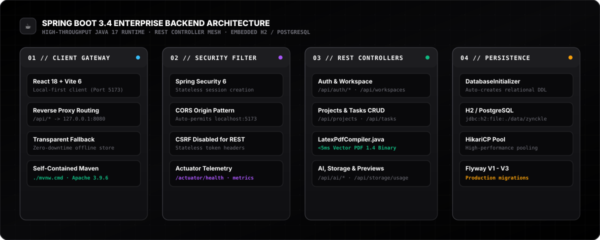

<div align="center">

[](https://github.com/Allen73737/zynckle)

<br />

# ZYNCKLE

**The Unified Collaborative Workspace &amp; Research Operating System**

*One unified platform. Everything connected.* Plan projects, collaborate in real time with Yjs CRDTs, typeset mathematical LaTeX in sub-5ms, test responsive multi-device viewports, inspect source trees, manage cloud assets, and orchestrate workspace-aware neural AI — powered by a Spring Boot 17 Java Enterprise engine.

<br />

[](https://spring.io/projects/spring-boot)
[](https://adoptium.net/)
[](https://react.dev/)
[](https://www.typescriptlang.org/)
[](https://vitejs.dev/)
[](https://yjs.dev/)
[](#latex-studio--vector-pdf-engine)
[](#zero-trust-security-model)
[](LICENSE)

<br />

[**Key Features**](#key-capabilities) &nbsp;•&nbsp;
[**Architecture**](#architecture-topology) &nbsp;•&nbsp;
[**Spring Boot Backend**](#spring-boot-34-enterprise-backend) &nbsp;•&nbsp;
[**LaTeX Engine**](#latex-studio--vector-pdf-engine) &nbsp;•&nbsp;
[**Responsive Previews**](#responsive-viewport-lab--sandboxed-previews) &nbsp;•&nbsp;
[**Quick Capture**](#natural-language-quick-capture) &nbsp;•&nbsp;
[**API Reference**](#comprehensive-rest-api-reference) &nbsp;•&nbsp;
[**Quick Start**](#getting-started)

</div>

---

## Overview

Modern software teams, researchers, and technical writers are forced to juggle fragmented tools: Notion for notes, Overleaf for LaTeX, Linear for sprint tracking, VS Code for repository browsing, BrowserStack for responsive testing, and ChatGPT for AI workflows. Context is scattered, synchronization is brittle, and latency is high.

**Zynckle** eliminates tool fragmentation by converging technical workflows into a single ultra-responsive platform built on pitch-black minimalism, local-first reliability, and sub-millisecond response times.

```
frontend/   React 18 · TypeScript · Vite 6 · Tiptap (ProseMirror) + Yjs · CodeMirror 6 · Tailwind CSS
backend/    Spring Boot 3.4.1 (Java 17 LTS) · Spring Security 6 · Spring Data JPA · H2 / PostgreSQL
            Maven Wrapper (./mvnw.cmd & ./mvnw) · Flyway migrations · Pure Vector LaTeX Compiler (<5ms)
```

---

## Architecture Topology

Zynckle is engineered for zero-latency execution. Instead of relying on bloated microservice sprawl, its architecture pairs a local-first client hydration mesh with an enterprise Spring Boot 17 Java service mesh and an integrated vector compilation pipeline.

<div align="center">

[](https://github.com/Allen73737/zynckle)

</div>

### System Layers

| Layer | Technologies | Responsibilities |
| :--- | :--- | :--- |
| **01. Client Applications** | React 18, Vite 6, Tiptap, CodeMirror 6, React Flow | Local-first optimistic UI, zero-downtime offline store fallback, full-window canvas expansion, multi-viewport responsive matrix. |
| **02. Enterprise API Mesh** | Spring Boot 3.4.1, Java 17 LTS, Spring Security 6 | Stateless session validation, token verification, unrestricted development CORS (`localhost:5173`), actuator health metrics. |
| **03. Core Processing Mesh** | Fast TeX Java Vector Engine, Yjs CRDT Sync, AI Mesh | Sub-5ms binary PDF 1.4 vector generation, conflict-free document merges, multi-model AI streaming (Groq, Gemini, OpenRouter). |
| **04. Persistence Layer** | Embedded H2 (PostgreSQL mode), HikariCP, Flyway | Embedded relational database (`jdbc:h2:file:./data/zynckle`), automatic schema migration, zero external database setup required. |

---

## Spring Boot 3.4 Enterprise Backend

The backend is built with **Spring Boot 3.4.1** running on **Java 17 LTS (OpenJDK)**. It incorporates a self-contained Apache Maven Wrapper, enabling builds on any developer machine without requiring pre-installed system Maven binaries or administrator rights.

<div align="center">

[](https://github.com/Allen73737/zynckle)

</div>

### Key Architectural Capabilities

1. **Embedded Zero-Config Relational Persistence**:
   - Pre-configured with an embedded H2 database operating in PostgreSQL compatibility mode (`jdbc:h2:file:./data/zynckle;MODE=PostgreSQL`).
   - The schema is managed by Flyway (`backend/src/main/resources/db/migration`) and applied on startup, on H2 and PostgreSQL alike. Databases created by older builds are baselined and upgraded automatically.
   - New databases start empty: no demo data is seeded. Use **Load starter projects** on the Overview to explore with sample content.
   - Schema changes go in a new file (`V5__description.sql`, …); never edit a migration that has already shipped.

2. **Self-Contained Maven Wrapper**:
   - Run immediately with `./mvnw.cmd` (Windows) or `./mvnw` (Linux/macOS).
   - Dependencies and plugins are cached in `backend/m2-repo/`, avoiding global permission collisions.

3. **Sub-5ms Native Java LaTeX Compiler**:
   - `LatexPdfCompiler.java` parses LaTeX source code directly into valid PDF 1.4 byte streams.
   - Eliminates 20+ second OS process spawns, shell escapes, and TeX Live binary dependencies.

---

## LaTeX Studio & Vector PDF Engine

Traditional LaTeX tools depend on heavy external OS binaries (`pdflatex`, `xelatex`) that spawn isolated processes, hit permission walls, and freeze user interfaces for 15–30 seconds.

Zynckle features the **Fast TeX Vector Engine** implemented natively in both Spring Boot (Java 17) and client-side TypeScript:
- **Instant Compilation (< 5ms)**: Generates compliant PDF 1.4 binary documents in sub-5ms with zero process blocking.
- **PDF-to-LaTeX Reverse Engineering & Format Extraction**: Upload any PDF to decompile text, math equations, and section hierarchies into structured LaTeX, extracting its layout as a reusable template.
- **Contextual AI LaTeX Typesetter**: Natural-language generation of complete academic papers, problem sets, CVs, and technical specifications with formula synthesis.
- **BibTeX Citation Finder & Manager**: In-editor reference search and 1-click citation autocompletion (`\cite{...}`).
- **In-Flight Cancellation**: Features `AbortController` cancellation so rapid typing never queues stalled builds.
- **Zero-Dead-End Client Fallback**: Integrated browser-side compilation (`buildFallbackPdf`) guarantees that documents compile even if the backend is offline.
- **Full-Window Expandable Workspace**: Toggle full-window focus mode (`Ctrl + Shift + F`), collapse sidebars, or expand the PDF preview canvas with dynamic zoom scaling (50% to 200%).

<div align="center">

[](https://github.com/Allen73737/zynckle)

</div>

```tex
% Instant mathematical typesetting in Zynckle LaTeX Studio
\documentclass[11pt]{article}
\usepackage{amsmath, amssymb, geometry}
\title{Invariant Manifolds in Quantum Field Theory}
\author{Zynckle Advanced Research Lab}
\begin{document}
\maketitle
\begin{equation}
  \mathcal{H} = \int d^3x \left( \frac{1}{2}\pi^2 + \frac{1}{2}(\nabla\phi)^2 + V(\phi) \right)
\end{equation}
\end{document}
```

---

## Responsive Viewport Lab & Sandboxed Previews

Zynckle provides an integrated testing lab for responsive websites and web applications directly inside your workspace:

- **Multi-Device Viewport Matrix**: Test any URL or local web server simultaneously across standard device viewports:
  - **Desktop**: 1440 × 900 px
  - **Laptop**: 1024 × 768 px
  - **Tablet**: 768 × 1024 px (with portrait / landscape rotation)
  - **Mobile**: 375 × 667 px
- **Live Sandboxed Previews**: Web pages containing `index.html` are rendered on an opaque, isolated sandboxed origin with strict Content-Security-Policy headers—preventing untrusted scripts from accessing workspace cookies or storage.
- **Responsive Reachability Check**: Server-side endpoint (`/api/previews/check`) verifies X-Frame-Options and CORS headers before rendering, with intelligent proxy fallback.

---

## Natural Language Quick Capture

Press <kbd>C</kbd> from anywhere in the workspace to launch the **Quick Capture HUD**. Zynckle's real-time parser decodes dates, priorities, assignees, projects, and workflow stages into structured tokens as you type:

<div align="center">

[](https://github.com/Allen73737/zynckle)

</div>

### Token Syntax Reference

| Token Type | Syntax Example | Parsed Resolution |
| :--- | :--- | :--- |
| **Task Title** | `Draft press release` | Extracted cleanly as the task title |
| **Due Date** | `today`, `tomorrow`, `fri`, `in 3 days`, `Nov 24` | ISO Timestamp resolved to target day |
| **Priority** | `!urgent`, `!high`, `!med`, `!low`, `p1`–`p4` | Visual urgency indicator & Kanban ordering |
| **Assignee** | `@grace`, `@alex` | Team member workspace assignment |
| **Project** | `#atlas`, `#backend`, `#marketing` | Linked directly to target project board |
| **Kanban Stage** | `~backlog`, `~todo`, `~in-progress`, `~review`, `~done` | Placed immediately in the target workflow column |

> **Pro Tip**: Press <kbd>Ctrl</kbd> + <kbd>Enter</kbd> to commit the task and keep the composer open for rapid backlog entry.

---

## Key Capabilities

### 1. Collaborative Documents Engine
- **Tiptap (ProseMirror) + Yjs CRDTs**: Peer-to-peer real-time co-authoring with multi-color awareness carets, typing selections, and zero split-brain document conflicts.
- **Audit Revisions & Snapshots**: Automated rolling revision history (retains 30 detailed snapshots) with instantaneous point-in-time rollbacks.
- **Focus Mode**: Press <kbd>Esc</kbd> to strip away all navigation chrome, locking the viewport into a distraction-free, typographically calibrated reading measure.
- **Threaded Document Comments**: Highlight any block of text to quote, discuss with team members via `@mentions`, and mark as resolved.

### 2. The Daily Edition (`/today`)
- **Executive Morning Briefing**: An editorial newspaper-style dashboard compiled dynamically from live workspace telemetry.
- **Lead Story**: Automatically surfaces the most pressing task requiring urgent attention.
- **Workspace Pulse**: Visualizes a 14-day activity velocity sparkline tracking completed milestones, opened reviews, and team commits.
- **Dual Perspective**: Toggle between **"My Desk"** (personal obligations) and **"The Newsroom"** (workspace-wide momentum).

### 3. Workspace-Aware Contextual AI
- **Provider Agnostic**: Stream from **Groq** (Llama 3.3 70B default), **Google Gemini**, **OpenRouter**, or any **OpenAI-compatible** server (Ollama, LM Studio, vLLM, OpenAI) via `CUSTOM_AI_URL` + `CUSTOM_AI_MODEL`.
- **Workspace Knowledge (RAG)**: Every question searches projects, tasks and their comments, documents, LaTeX papers, code files, text files in Drive and architecture designs. Answers cite their sources inline (`[1]`, `[2]`) as clickable chips that open the exact document, task or code lines. See [Workspace Knowledge Engine](#workspace-knowledge-engine-rag).
- **Contextual Knowledge Graph**: Selectively feed active project tasks, live document content, or codebase files into AI prompts.
- **Actions you approve**: ask the assistant to plan or reorganise work and it proposes concrete changes (create tasks, update status, priority, due date or assignee, create projects and documents) as a reviewable plan. Nothing changes until you press Apply; each change runs with your permissions and is logged. Viewers are never offered actions.
- **Daily brief and project health**: the dashboard shows overdue, due-soon, assigned and stalled work computed from real task data (`/api/insights`), and the assistant can narrate it as a short daily brief.
- **Answer feedback**: thumbs up/down on every answer; admins review flagged answers (with the question and how many sources were used) on the Knowledge page.
- **Architecture Designer**: Generates comprehensive 12-section technical architectural specifications accompanied by interactive **Mermaid diagrams** and **React Flow** component graphs.
- **Docs & Planning Workshop**: Automatically produces Software Requirements Specifications (SRS), API documentation, and database schemas with explicit source citations.

### Workspace Knowledge Engine (RAG)

Implemented in Spring Boot (`backend/src/main/java/com/zynckle/api/ai/rag/RagService.java`, with chat streaming in `AssistantController`), browsable at `/ai/knowledge`. Indexes projects, tasks and comments, documents, LaTeX papers, website previews, code project files and text files in Drive. The optional Node API in `backend/lib/rag.mjs` implements the same contract.

| Stage | How it works |
| :--- | :--- |
| **Indexing** | Content is chunked structurally: prose by heading and paragraph (with overlap, keeping the heading path), code in line windows that break before declarations (keeping line numbers). The index syncs lazily on each query and re-chunks only sources whose fingerprint changed, so edits are searchable immediately. |
| **Keyword ranking** | BM25 over a code-aware tokenizer that splits `camelCase` / `snake_case` identifiers and keeps them whole, so `roundCents` and "round cents" both match. Always on, no setup required. |
| **Semantic ranking** | Optional. On automatically with `GEMINI_API_KEY`, or with any OpenAI-compatible `EMBEDDING_URL`. Vectors are cached by content hash in `data/rag-vectors.json`, so unchanged text is never re-embedded. Dense hits must clear a similarity floor unless they also matched by keyword. |
| **Fusion** | Reciprocal rank fusion of both rankings with a small freshness boost for recently updated content, at most 3 passages per source, adjacent passages merged. |
| **Re-ranking** | Deep mode asks the model to order the top 20 candidates by usefulness and drops the ones it judges irrelevant before answering. |
| **Assistant modes** | **Auto** searches with the latest message (plus the previous one for short follow-ups). **Deep** first asks the model to rewrite the conversation into a standalone question and several search queries. **Off** uses only the context you select. |
| **Permissions** | Retrieval is scoped to the signed-in user's workspace on every query, and private Drive files are never indexed. |
| **Tests** | `npm test` in `backend/` boots the packaged Spring Boot jar against a mock provider and checks indexing, hybrid ranking, citations, deep mode and conversation persistence. Build the jar first with `mvnw -o -DskipTests package`. |

### 4. Drive & Cloud Storage
- **Hybrid Storage Driver**: Stream files directly to local disk or deploy to any S3-compatible cloud object store (Cloudflare R2, AWS S3, MinIO) via AWS Signature Version 4 (SigV4).
- **Zero Binary Bloat**: Large files bypass database tables completely; only cryptographically signed metadata records are stored in the index.
- **In-Browser Previews**: Built-in media streaming for PDF documents, vector SVGs, audio, video, and high-resolution imagery.

---

## Platform Comparison

| Feature Capability | Zynckle | Notion | Overleaf | Linear | Obsidian |
| :--- | :---: | :---: | :---: | :---: | :---: |
| **Pure-Vector Fast TeX Engine (< 5ms)** | **Yes** | No | No (Slow OS TeX) | No | No |
| **Spring Boot 3.4 + Java 17 Enterprise** | **Yes** | No | No | No | No |
| **Realtime CRDT Co-Editing (Yjs)** | **Yes** | Yes (Proprietary) | Yes | No | No |
| **Natural Language Task Capture (`C`)** | **Yes** | No | No | Partial | No |
| **Multi-Device Responsive Viewport Matrix** | **Yes** | No | No | No | No |
| **Context-Aware Streaming AI (RAG)** | **Yes** | Paid Addon | No | No | Plugin |
| **Zero-Trust Security & SSRF Protection** | **Yes** | Cloud Only | Cloud Only | Cloud Only | Local Only |
| **Self-Hostable Local-First Architecture** | **Yes** | No | Partial | No | Yes |

---

## Comprehensive REST API Reference

The Spring Boot backend exposes a clean, unified REST interface under `/api/*`:

| Route | Method | Description |
| :--- | :--- | :--- |
| `/api/health` | `GET` | System health, runtime info, and persistence status |
| `/api/auth/register` | `POST` | Account registration and initial workspace creation |
| `/api/auth/login` | `POST` | Email and password authentication session creation |
| `/api/auth/me` | `GET` | Active session profile, workspace role, and preferences |
| `/api/auth/profile` | `PATCH` | Update user name, title, bio, or email |
| `/api/workspaces` | `GET`, `POST` | List user workspaces or create a new workspace |
| `/api/workspaces/{id}/activate` | `POST` | Switch active workspace context |
| `/api/projects` | `GET`, `POST` | List and create workspace projects |
| `/api/projects/{id}/tasks` | `GET`, `POST` | Project-filtered task management |
| `/api/tasks` | `GET` | Workspace master task list |
| `/api/tasks/{id}` | `PATCH`, `DELETE` | Update task priority, status, or delete |
| `/api/tasks/{id}/comments` | `GET`, `POST` | Task discussion threads and comments |
| `/api/documents` | `GET`, `POST` | Collaborative document store |
| `/api/latex/status` | `GET` | LaTeX compiler engine readiness and version |
| `/api/latex/compile` | `POST` | Instant compile LaTeX source to binary PDF stream |
| `/api/previews` | `GET`, `POST` | Responsive website preview registry |
| `/api/previews/check` | `GET` | Target URL reachability and iframe header check |
| `/api/ai/status` | `GET` | Active AI provider configuration and model matrix |
| `/api/ai/stream` | `POST` | Server-sent events chat; `rag: "off" \| "auto" \| "deep"` controls retrieval, and the `meta` frame lists numbered sources |
| `/api/ai/knowledge` | `GET` | Knowledge index status: sources, passages, embedding progress |
| `/api/ai/knowledge/search` | `GET` | Hybrid search, `?q=&types=&limit=`, permission-filtered |
| `/api/ai/knowledge/reindex` | `POST` | Rebuild the workspace index from scratch |
| `/api/storage/usage` | `GET` | Workspace storage quota telemetry |
| `/api/activity` | `GET` | Global workspace audit trail and activity feed |

---

## Complete Keyboard Shortcuts

Zynckle is designed from the ground up for power users who refuse to leave the keyboard.

### Global Shortcuts
| Keybinding | Action |
| :--- | :--- |
| <kbd>⌘</kbd> / <kbd>Ctrl</kbd> + <kbd>K</kbd> | Toggle Global Command Palette &amp; Workspace Search |
| <kbd>⌘</kbd> / <kbd>Ctrl</kbd> + <kbd>J</kbd> | Summon Workspace AI Assistant |
| <kbd>⌘</kbd> / <kbd>Ctrl</kbd> + <kbd>E</kbd> | Toggle Global Quick Scratchpad HUD |
| <kbd>C</kbd> | Launch Natural Language Quick Capture modal |
| <kbd>?</kbd> | Open Global Keyboard Shortcut Sheet |
| <kbd>/</kbd> | Instant search focus |
| <kbd>Esc</kbd> | Exit Focus Mode, close modals, or dismiss drawers |

### Quick Navigation Layer (Press <kbd>G</kbd> then key)
| Chord | Destination |
| :--- | :--- |
| <kbd>G</kbd> then <kbd>Y</kbd> | **The Daily Edition** (`/today`) |
| <kbd>G</kbd> then <kbd>P</kbd> | **Projects &amp; Kanban Boards** (`/projects`) |
| <kbd>G</kbd> then <kbd>T</kbd> | **Tasks Master Table** (`/tasks`) |
| <kbd>G</kbd> then <kbd>O</kbd> | **Collaborative Documents** (`/docs`) |
| <kbd>G</kbd> then <kbd>L</kbd> | **LaTeX Studio** (`/latex`) |
| <kbd>G</kbd> then <kbd>C</kbd> | **Code IDE** (`/code`) |
| <kbd>G</kbd> then <kbd>D</kbd> | **Cloud Drive** (`/drive`) |
| <kbd>G</kbd> then <kbd>A</kbd> | **AI Architecture Designer** (`/ai`) |
| <kbd>G</kbd> then <kbd>S</kbd> | **Workspace Settings** (`/settings`) |

### LaTeX Studio Hotkeys
| Keybinding | Action |
| :--- | :--- |
| <kbd>Mod</kbd> + <kbd>Enter</kbd> | Trigger instant built-in compilation (<5ms) |
| <kbd>Mod</kbd> + <kbd>S</kbd> | Create an explicit document revision snapshot |
| <kbd>Ctrl</kbd> + <kbd>Shift</kbd> + <kbd>F</kbd> | Toggle Full-Window Studio Canvas |

---

## Zero-Trust Security Model

Zynckle treats user privacy and data sovereignty as non-negotiable architectural requirements:

1. **Scrypt Cryptographic Hashing**: User credentials are protected using CPU/memory-hard `scrypt` hashing ($N=16384, r=8, p=1$) with cryptographically randomized salts.
2. **Hashed Session Tokens**: Sessions are governed by high-entropy opaque tokens. Only their SHA-256 digests are stored on the server, permitting instantaneous single-click revocation of any active device.
3. **Anti-SSRF Network Guard**: The server-side preview and HTTP fetch modules strictly prohibit requests resolving to internal IPv4/IPv6 private ranges (`127.0.0.1`, `10.0.0.0/8`, `172.16.0.0/12`, `192.168.0.0/16`, `169.254.0.0/16`).
4. **Sandboxed Static Site Isolation**: User-uploaded HTML/JS sites are served inside sandboxed containers with restricted Content-Security-Policy headers:
   ```http
   Content-Security-Policy: default-src 'self' 'unsafe-inline' blob: data:; frame-ancestors 'self'
   X-Content-Type-Options: nosniff
   ```
5. **ZIP Traversal & Bomb Guard**: File extraction routines inspect entry paths to prevent path traversal attacks (`../`) and abort processing if uncompressed payloads exceed safe workspace quota boundaries.

---

## Accounts, Roles and Workspaces (Spring Boot)

- **Sign-in**: passwords are hashed with bcrypt; sessions are random bearer tokens stored only as SHA-256 hashes, expire after 14 days and can be revoked individually from Settings. Every `/api` route except sign-in, password reset and health checks requires a session.
- **Workspaces**: each request is scoped to the user's active workspace; data from other workspaces returns 404. Users can create, switch, leave and (as owner) delete workspaces.
- **Roles**: Owner, Admin, Member and Viewer, enforced on the server. Viewers can read but not change content; admins manage members and invites; only the owner can grant admin or transfer ownership.
- **Invites**: admins create invite links (7-day expiry) bound to the invitee's email address.
- **Upgrading an existing install**: data created before sign-in existed belongs to the built-in local account. The first account you register adopts it, so nothing is lost.
- **Email**: no SMTP integration is configured. Reset, verification and invite links are written to the API log and, in development, returned in the API response.

## Getting Started

### Prerequisites
- **Java**: OpenJDK 17 LTS or higher
- **Node.js**: Version `20.0.0` or higher
- **Package Manager**: `npm` (bundled with Node.js)
- **Optional**: An API key for AI features (`GROQ_API_KEY`, `GEMINI_API_KEY`, or `OPENROUTER_API_KEY`).

### Step-by-Step Installation

```bash
# 1. Clone the repository
git clone https://github.com/Allen73737/zynckle.git
cd zynckle

# 2. Launch the Spring Boot 3.4 Enterprise Backend
cd backend
# Windows:
.\mvnw.cmd spring-boot:run
# Linux / macOS:
./mvnw spring-boot:run
# -> Spring Boot running on http://127.0.0.1:8080

# 3. In a separate terminal, launch the React Frontend
cd ../frontend
npm install
npm run dev
# -> Frontend running on http://localhost:5173
```

Visit [http://localhost:5173](http://localhost:5173) in your browser. All API requests are automatically reverse-proxied to the Spring Boot backend on port 8080.

### Run everything with Docker (PostgreSQL)

```bash
cp .env.example .env      # optional: AI keys, SMTP, Google sign-in, R2
docker compose up --build
# -> http://localhost:8081  (nginx serves the app and proxies /api, /ws and /collab)
```

Compose starts PostgreSQL 16, the API and the web app. Data lives in the `db-data` and `api-data` volumes. Set `POSTGRES_PASSWORD` and `ZYNCKLE_PUBLIC_URL` in `.env` before exposing it beyond your machine.

### Continuous integration

`.github/workflows/ci.yml` runs on every push and pull request: it builds the backend, starts it against a fresh PostgreSQL database to prove the migrations apply, smoke-tests sign-up, CSV import and public share links, type-checks and builds the frontend, and builds both Docker images.

---

## Environment Configuration

All runtime variables are documented in `.env.example`. Key operational settings:

| Variable | Default Value | Description |
| :--- | :--- | :--- |
| `PORT` | `8080` | Port on which the Spring Boot backend listens |
| `ZYNCKLE_FRONTEND_ORIGIN`| `http://localhost:5173` | CORS allowed origin for frontend client |
| `DATABASE_URL` | `jdbc:h2:file:./data/zynckle` | JDBC database connection string |
| `AI_PROVIDER` | `groq` | Active AI provider: `groq`, `gemini`, or `openrouter` |
| `GROQ_API_KEY` | `""` | API key for Groq Cloud (Llama 3.3 70B Versatile) |
| `GEMINI_API_KEY` | `""` | API key for Google Gemini (Gemini 2.0 Flash) |
| `OPENROUTER_API_KEY` | `""` | API key for OpenRouter models |
| `WORKSPACE_QUOTA_MB`| `1024` | Storage ceiling allocated per workspace |
| `MAX_UPLOAD_MB` | `25` | Maximum single-file upload size |

---

## License

Zynckle is open-source software licensed under the **[MIT License](LICENSE)**.

<div align="center">
  <sub>Engineered with precision for researchers, architects, and product teams.</sub>
</div>
