<div align="center">



<br />

# ZYNCKLE

**The Unified Collaborative Workspace &amp; Research Operating System**

*One unified platform. Everything connected.* Plan projects, collaborate in real time, typeset mathematical LaTeX, inspect source code, preview live sandboxed websites, manage cloud assets, and orchestrate workspace-aware AI — without ever context-switching.

<br />

[](https://nodejs.org/)
[](https://react.dev/)
[](https://www.typescriptlang.org/)
[](https://vitejs.dev/)
[](https://yjs.dev/)
[](#latex-studio--vector-pdf-engine)
[](#zero-trust-security-model)
[](LICENSE)

<br />

[**Key Features**](#key-capabilities) &nbsp;•&nbsp;
[**Architecture**](#architecture-topology) &nbsp;•&nbsp;
[**LaTeX Engine**](#latex-studio--vector-pdf-engine) &nbsp;•&nbsp;
[**Quick Capture**](#natural-language-quick-capture) &nbsp;•&nbsp;
[**Keyboard Shortcuts**](#complete-keyboard-shortcuts) &nbsp;•&nbsp;
[**Quick Start**](#getting-started) &nbsp;•&nbsp;
[**Security Model**](#zero-trust-security-model)

</div>

---

## Overview

Modern engineering teams, researchers, and technical writers are forced to juggle fragmented tools: Notion for documents, Overleaf for LaTeX, Linear for issue tracking, VS Code for repository browsing, and ChatGPT for AI workflows. Context is scattered, sync is brittle, and latency is high.

**Zynckle** eliminates tool fragmentation by converging technical workflows into a single ultra-responsive, local-first platform built on pitch-black minimalism and sub-millisecond responsiveness.

```
frontend/   React 18 · TypeScript · Vite 6 · Tiptap (ProseMirror) + Yjs · CodeMirror 6 · React Flow · Mermaid
backend/    Node.js Zero-Dependency Core · WebSockets (ws) · Yjs CRDT Sync Server · Atomic Journal Store
            backend/src = Spring Boot / PostgreSQL reference schema with Flyway V1-V3 migrations
```

---

## Architecture Topology

Zynckle is engineered for zero-latency execution. Instead of relying on bloated monolithic frameworks, its edge gateway utilizes lightweight streaming protocols and an integrated vector compilation pipeline.

<div align="center">
  
</div>

### System Layers

| Layer | Technologies | Responsibilities |
| :--- | :--- | :--- |
| **01. Client Applications** | React 18, Vite 6, Tiptap, CodeMirror 6, React Flow | Local-first optimistic UI, dual-engine fallback store, split-pane IDE, zero-flicker state hydration. |
| **02. Realtime Edge Gateway** | Node.js native HTTP/WebSocket, `ws`, Scrypt, CSP | Token-bucket rate limiting, opaque session verification, SSRF blocking, sub-millisecond multiplexed message dispatch. |
| **03. Core Processing Mesh** | Fast TeX Pure-JS Compiler, Yjs Sync Server, AI Mesh, S3/R2 SigV4 | Instant PDF 1.4 vector generation, conflict-free document merges, multi-model AI streaming (Groq, Gemini, OpenRouter), and streaming signed uploads. |

---

## LaTeX Studio & Vector PDF Engine

Traditional LaTeX suites rely on external OS toolchains (`pdflatex`, `xelatex`) that spawn heavy OS processes, encounter permission errors, and freeze user interfaces for 20+ seconds.

Zynckle introduces the **Fast TeX Pure-JS Vector Engine**:
- **Instant Compilation (< 5ms)**: Generates compliant PDF 1.4 binary documents in pure JavaScript with zero OS process spawning and zero registry dependencies.
- **In-Flight Cancellation**: Features `AbortController` cancellation so rapid typing never queues stalled builds.
- **Zero-Dead-End Client Fallback**: Integrated browser-side compilation (`buildFallbackPdf`) guarantees that documents compile even if the server is offline or unreachable.
- **Full-Window Expandable Workspace**: Toggle full-window focus mode (`Ctrl + Shift + F`), collapse sidebars, or expand the PDF preview canvas with dynamic zoom scaling (50% to 200%).

<div align="center">
  
</div>

```tex
% Instant mathematical typesetting in Zynckle LaTeX Studio
\documentclass[11pt]{article}
\usepackage{amsmath, amssymb, geometry}
\title{Invariant Manifolds in Quantum Field Theory}
\author{Zynckle Advanced Research Lab}
\begin{document}
\maketitle
\begin{equation}
  \mathcal{H} = \int d^3x \left( \frac{1}{2}\pi^2 + \frac{1}{2}(\nabla\phi)^2 + V(\phi) \right)
\end{equation}
\end{document}
```

---

## Natural Language Quick Capture

Press <kbd>C</kbd> from anywhere in the workspace to launch the **Quick Capture HUD**. Zynckle's real-time parser decodes dates, priorities, assignees, projects, and workflow stages into structured tokens as you type:

<div align="center">
  
</div>

### Token Syntax Reference

| Token Type | Syntax Example | Parsed Resolution |
| :--- | :--- | :--- |
| **Task Title** | `Draft press release` | Extracted cleanly as the task title |
| **Due Date** | `today`, `tomorrow`, `fri`, `in 3 days`, `Nov 24` | ISO Timestamp resolved to target day |
| **Priority** | `!urgent`, `!high`, `!med`, `!low`, `p1`–`p4` | Visual urgency indicator & Kanban ordering |
| **Assignee** | `@grace`, `@alex` | Team member workspace assignment |
| **Project** | `#atlas`, `#backend`, `#marketing` | Linked directly to target project board |
| **Kanban Stage** | `~backlog`, `~todo`, `~in-progress`, `~review`, `~done` | Placed immediately in the target workflow column |

> **Pro Tip**: Press <kbd>Ctrl</kbd> + <kbd>Enter</kbd> to commit the task and keep the composer open for rapid backlog entry.

---

## Key Capabilities

### 1. Collaborative Documents Engine
- **Tiptap (ProseMirror) + Yjs CRDTs**: Peer-to-peer real-time co-authoring with multi-color awareness carets, typing selections, and zero split-brain document conflicts.
- **Audit Revisions & Snapshots**: Automated rolling revision history (retains 30 detailed snapshots) with instantaneous point-in-time rollbacks.
- **Focus Mode**: Press <kbd>Esc</kbd> to strip away all navigation chrome, locking the viewport into a distraction-free, typographically calibrated reading measure.
- **Threaded Document Comments**: Highlight any block of text to quote, discuss with team members via `@mentions`, and mark as resolved.

### 2. The Daily Edition (`/today`)
- **Executive Morning Briefing**: An editorial newspaper-style dashboard compiled dynamically from live workspace telemetry.
- **Lead Story**: Automatically surfaces the most pressing task requiring urgent attention.
- **Workspace Pulse**: Visualizes a 14-day activity velocity sparkline tracking completed milestones, opened reviews, and team commits.
- **Dual Perspective**: Toggle between **"My Desk"** (personal obligations) and **"The Newsroom"** (workspace-wide momentum).

### 3. Code Studio & Sandboxed Previews
- **Syntax-Highlighted Tree Browser**: Inspect full codebases with line numbers, full-text fuzzy code search, and instant jumping.
- **One-Click GitHub Import**: Pull public repositories directly into your project with zero local git overhead.
- **Sandboxed Static Previews**: Projects containing `index.html` are rendered on an opaque, isolated sandboxed origin with strict Content-Security-Policy headers—preventing untrusted scripts from accessing workspace cookies or storage.
- **Responsive Viewport Lab**: Test web layouts across Desktop (1440px), Laptop (1024px), Tablet (768px), and Mobile (375px) viewports with orientation flipping.

### 4. Workspace-Aware Contextual AI
- **Provider Agnostic**: Seamlessly stream intelligence via **Groq** (Llama 3.3 70B default), **Google Gemini** (Gemini 2.0 Flash / Pro), or **OpenRouter**.
- **Contextual Knowledge Graph**: Selectively feed active project tasks, live document content, or codebase files into AI prompts.
- **Architecture Designer**: Generates comprehensive 12-section technical architectural specifications accompanied by interactive **Mermaid diagrams** and **React Flow** component graphs.
- **Docs & Planning Workshop**: Automatically produces Software Requirements Specifications (SRS), API documentation, and database schemas with explicit source citations.

### 5. Drive & Object Storage
- **Hybrid Storage Driver**: Stream files directly to local disk or deploy to any S3-compatible cloud object store (Cloudflare R2, AWS S3, MinIO) via AWS Signature Version 4 (SigV4).
- **Zero Binary Bloat**: Large files bypass database tables completely; only cryptographically signed metadata records are stored in the index.
- **In-Browser Previews**: Built-in media streaming for PDF documents, vector SVGs, audio, video, and high-resolution imagery.

---

## Platform Comparison

| Feature Capability | Zynckle | Notion | Overleaf | Linear | Obsidian |
| :--- | :---: | :---: | :---: | :---: | :---: |
| **Pure-JS Fast TeX Engine (< 5ms)** | **Yes** | No | No (Slow OS TeX) | No | No |
| **Realtime CRDT Co-Editing (Yjs)** | **Yes** | Yes (Proprietary) | Yes | No | No |
| **Natural Language Task Capture (`C`)** | **Yes** | No | No | Partial | No |
| **Interactive Code IDE & Sandboxed Previews** | **Yes** | No | No | No | No |
| **Context-Aware Streaming AI (RAG)** | **Yes** | Paid Addon | No | No | Plugin |
| **Zero-Trust Security & SSRF Protection** | **Yes** | Cloud Only | Cloud Only | Cloud Only | Local Only |
| **Self-Hostable Local-First Architecture** | **Yes** | No | Partial | No | Yes |

---

## Complete Keyboard Shortcuts

Zynckle is designed from the ground up for power users who refuse to leave the keyboard.

### Global Shortcuts
| Keybinding | Action |
| :--- | :--- |
| <kbd>⌘</kbd> / <kbd>Ctrl</kbd> + <kbd>K</kbd> | Toggle Global Command Palette &amp; Workspace Search |
| <kbd>⌘</kbd> / <kbd>Ctrl</kbd> + <kbd>J</kbd> | Summon Workspace AI Assistant |
| <kbd>C</kbd> | Launch Natural Language Quick Capture modal |
| <kbd>?</kbd> | Open Global Keyboard Shortcut Sheet |
| <kbd>/</kbd> | Instant search focus |
| <kbd>Esc</kbd> | Exit Focus Mode, close modals, or dismiss drawers |

### Quick Navigation Layer (Press <kbd>G</kbd> then key)
| Chord | Destination |
| :--- | :--- |
| <kbd>G</kbd> then <kbd>Y</kbd> | **The Daily Edition** (`/today`) |
| <kbd>G</kbd> then <kbd>P</kbd> | **Projects &amp; Kanban Boards** (`/projects`) |
| <kbd>G</kbd> then <kbd>T</kbd> | **Tasks Master Table** (`/tasks`) |
| <kbd>G</kbd> then <kbd>O</kbd> | **Collaborative Documents** (`/docs`) |
| <kbd>G</kbd> then <kbd>L</kbd> | **LaTeX Studio** (`/latex`) |
| <kbd>G</kbd> then <kbd>C</kbd> | **Code IDE** (`/code`) |
| <kbd>G</kbd> then <kbd>D</kbd> | **Cloud Drive** (`/drive`) |
| <kbd>G</kbd> then <kbd>A</kbd> | **AI Architecture Designer** (`/ai`) |
| <kbd>G</kbd> then <kbd>S</kbd> | **Workspace Settings** (`/settings`) |

### LaTeX Studio Hotkeys
| Keybinding | Action |
| :--- | :--- |
| <kbd>Mod</kbd> + <kbd>Enter</kbd> | Trigger instant built-in compilation |
| <kbd>Mod</kbd> + <kbd>S</kbd> | Create an explicit document revision snapshot |
| <kbd>Ctrl</kbd> + <kbd>Shift</kbd> + <kbd>F</kbd> | Toggle Full-Window Studio Canvas |

---

## Zero-Trust Security Model

Zynckle treats user privacy and data sovereignty as non-negotiable architectural requirements:

1. **Scrypt Cryptographic Hashing**: User credentials are protected using CPU/memory-hard `scrypt` hashing ($N=16384, r=8, p=1$) with cryptographically randomized salts.
2. **Hashed Session Tokens**: Sessions are governed by high-entropy opaque tokens. Only their SHA-256 digests are stored on the server, permitting instantaneous single-click revocation of any active device.
3. **Anti-SSRF Network Guard**: The server-side preview and HTTP fetch modules strictly prohibit requests resolving to internal IPv4/IPv6 private ranges (`127.0.0.1`, `10.0.0.0/8`, `172.16.0.0/12`, `192.168.0.0/16`, `169.254.0.0/16`).
4. **Sandboxed Static Site Isolation**: User-uploaded HTML/JS sites are served inside sandboxed containers with restricted Content-Security-Policy headers:
   ```http
   Content-Security-Policy: default-src 'self' 'unsafe-inline' blob: data:; frame-ancestors 'self'
   X-Content-Type-Options: nosniff
   ```
5. **ZIP Traversal & Bomb Guard**: File extraction routines inspect entry paths to prevent path traversal attacks (`../`) and abort processing if uncompressed payloads exceed safe workspace quota boundaries.

---

## Getting Started

### Prerequisites
- **Node.js**: Version `20.0.0` or higher
- **Package Manager**: `npm` (bundled with Node.js)
- **Optional**: An API key for AI features (`GROQ_API_KEY`, `GEMINI_API_KEY`, or `OPENROUTER_API_KEY`).

### Step-by-Step Installation

```bash
# 1. Clone the repository
git clone https://github.com/Allen73737/zynckle.git
cd zynckle

# 2. Copy the environment template
cp .env.example .env

# 3. Install backend dependencies and launch API server
cd backend
npm install
npm start
# -> Backend listening on http://127.0.0.1:8080

# 4. In a separate terminal, launch the frontend
cd ../frontend
npm install
npm run dev
# -> Frontend running on http://localhost:5173
```

Visit [http://localhost:5173](http://localhost:5173) in your browser to create your initial workspace account.

---

## Environment Configuration

All runtime variables are documented in `.env.example`. Key operational settings:

| Variable | Default Value | Description |
| :--- | :--- | :--- |
| `ZYNCKLE_PORT` | `8080` | Port on which the Node backend listens |
| `ZYNCKLE_SECRET` | *(Random)* | Secret key used for session authentication cookies |
| `LATEX_COMPILER` | `built-in` | `built-in` for instant 5ms vector TeX; or custom binary path |
| `AI_PROVIDER` | `groq` | Active AI provider: `groq`, `gemini`, or `openrouter` |
| `GROQ_API_KEY` | `""` | API key for Groq Cloud (Llama 3.3 70B Versatile) |
| `GEMINI_API_KEY` | `""` | API key for Google Gemini (Gemini 2.0 Flash) |
| `OPENROUTER_API_KEY` | `""` | API key for OpenRouter models |
| `WORKSPACE_QUOTA_MB`| `1024` | Storage ceiling allocated per workspace |
| `MAX_UPLOAD_MB` | `25` | Maximum single-file upload size |
| `AUTH_RATE_PER_MINUTE` | `12` | Throttling bucket for authentication attempts |
| `LATEX_RATE_PER_MINUTE` | `120` | Compilation requests permitted per client minute |

---

## Verification & Test Suite

The repository includes a comprehensive automated test harness covering API security, RBAC enforcement, and data isolation.

```bash
# Execute integration test suites (12 comprehensive suites)
cd backend
npm test

# Run strict TypeScript static analysis
cd ../frontend
npx tsc --noEmit

# Compile production bundle with code-splitting
npm run build
```

---

## License

Zynckle is open-source software licensed under the **[MIT License](LICENSE)**.

<div align="center">
  <sub>Engineered with precision for researchers, architects, and product teams.</sub>
</div>
